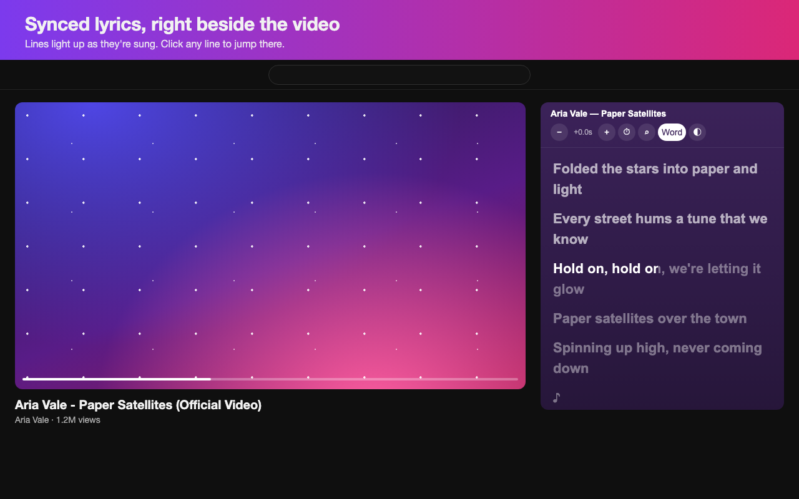

# getlyrics [](https://github.com/imdeener/getlyrics/actions/workflows/test.yml)

Real-time synced lyrics beside the YouTube player, with karaoke-style word highlighting. A Chrome extension (Manifest V3) powered by [LRCLIB](https://lrclib.net). No account, no API key.



## Features

- **Auto-detects the song**: uses the song credits in YouTube's "Music" section when there are any. Otherwise it reads the video title. Strips clutter like `(Official MV)`, `[HD]`, `| Label`, `feat. ...`. Handles `Artist - Song`, `Song - Artist`, and K-pop style `ARTIST 'Song' M/V`. If nothing matches, it retries without version tags like `(Remix)` or `[Thai ver.]`.
- **Synced lyrics panel** at the top of the sidebar. The current line is highlighted and scrolls into view. Click any line to jump there.
- **Word-by-word highlight** that fills each word as it's sung. Uses real word timings when the lyrics include them (enhanced LRC). Otherwise it estimates them. Splits words correctly for languages without spaces (Thai, Japanese, Chinese) via `Intl.Segmenter`.
- **Fullscreen overlay** showing the current and next line over the video.
- **Quick sync**: out of sync? Press `⏱`, then click the line being sung right now, and the timing snaps into place. Shortcut: Alt+click (Option+click on Mac) a line. `−` / `+` fine-tune it by 0.5s. The offset is saved per video.
- **Mismatch warning**: if the lyrics' length differs from the video by more than 10s (MV intro, different version), a hint tells you how to fix it.
- **Manual search**: if the auto-match is wrong or missing, press `⌕`, enter the artist and title, and pick a result. Your choice is remembered for that video.
- **Themes**: color from the video thumbnail, dark, or light.
- **Localized UI**: English and Thai. Follows the browser's language.

## Install

From source (until it's on the Chrome Web Store):

1. Download `getlyrics-x.y.z.zip` from the [latest release](https://github.com/imdeener/getlyrics/releases/latest) and unzip it. Or clone the repo.
2. Open `chrome://extensions` and turn on **Developer mode**.
3. Click **Load unpacked** and select the unzipped (or cloned) folder.
4. Open any music video on youtube.com.

## How it works

| File | Role |
|---|---|
| `parse.js` | Pure functions: video title → artist/track, LRC → timed lines, line → word timings |
| `content.js` | Runs on youtube.com: watches SPA navigation, renders the panel and overlay, syncs to `<video>` |
| `background.js` | Service worker: queries the LRCLIB API, picks the best match by synced lyrics and duration, extracts the thumbnail color |
| `content.css` | Panel and overlay styles |
| `_locales/` | UI strings per language |

No build step and no dependencies.

## Privacy

getlyrics doesn't collect anything. It reads the song credits by loading the current video's YouTube page in the background. To find lyrics it sends the detected artist, title, and duration of the video you're watching to `lrclib.net`. It also fetches the video thumbnail from `i.ytimg.com` to pick a theme color. Settings, offsets, and manual picks stay in your browser's local extension storage.

## Known limitations

- An MV with an intro plays ahead of the audio version that the lyrics are timed to. Fix it with `⏱` (quick sync) or `−` / `+`.
- A mid-song dance break or skit can't be fixed with a single offset.
- Some LRCLIB entries have broken timing, for example every line squeezed into the last minute. getlyrics detects this and shows those lyrics unsynced instead of stuck.
- When LRCLIB is overloaded it turns away its heavier requests. getlyrics falls back to the lighter artist + title lookups that keep working, and only reports "couldn't reach LRCLIB" when nothing got through.
- Coverage depends on LRCLIB. Lyrics there are community-contributed, so some songs are missing or slightly off.

## Contributing

Issues and PRs are welcome.

- **Add a language**: copy `_locales/en/messages.json` to `_locales/<code>/messages.json` and translate the `message` values. No code changes are needed.
- **Title parsing**: if a video title is detected wrongly, add it as a case in `test/parse.test.js` and fix `parse.js`.
- **Tests**: CI runs them on every push and PR. To run them locally:

  ```sh
  node --test
  ```

  This needs Node 20 or newer.
- **Screenshots**: `store/screenshots.js` renders the store images from mock pages that use the real `content.css`, with a made-up song. To regenerate them, run `CHROME=/path/to/chrome node store/screenshots.js`. The icons come from `python3 store/icon.py`, which needs Pillow.

## Credits

Lyrics data from [LRCLIB](https://lrclib.net), a free, community-maintained lyrics database. Please consider contributing lyrics there.

## License

[MIT](LICENSE)
